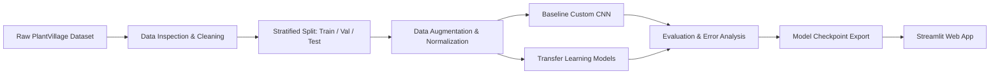

# Crop Disease Detection Using Deep Learning

An educational, reproducible deep learning project for plant pathology diagnosis, starting with **Tomato Leaf Disease Classification** using the PlantVillage dataset.

Developed for a two-phase college hackathon, this project emphasizes understanding the core mechanics of Computer Vision and PyTorch—from tensor operations and custom CNN architectures to transfer learning, evaluation metrics, and interactive deployment.

---

## 🎯 Project Objectives

1. **Understand Deep Learning Fundamentals**: Build an intuitive, mathematical, and practical understanding of Convolutional Neural Networks (CNNs), feature extraction, loss functions, and backpropagation.
2. **Robust Data Pipeline**: Implement reliable dataset download, validation, exploratory analysis (EDA), preprocessing, and leakage-free dataset splitting (train/val/test).
3. **Model Development**:
   - **Phase 1**: Custom lightweight CNN baseline trained from scratch to understand architectural decisions (kernel sizes, pooling, activation functions, regularization).
   - **Phase 2**: Transfer learning using established backbones (e.g., MobileNetV2, ResNet18/50) to evaluate performance gains and efficiency on edge devices.
4. **Comprehensive Evaluation**: Analyze confusion matrices, per-class precision/recall/F1-score, and conduct rigorous error analysis on misclassified leaf images.
5. **Interactive Demonstration**: Build a lightweight, local Streamlit web application allowing users to upload leaf photos and receive real-time disease predictions with confidence intervals.

---

## 🛠️ Technology Stack

| Layer | Technology |
|---|---|
| **Language** | Python 3.10+ |
| **Deep Learning Framework** | [PyTorch](https://pytorch.org/) & [torchvision](https://pytorch.org/vision/) |
| **Hardware Acceleration** | Apple Silicon MPS (`torch.backends.mps`) with CPU fallback |
| **Image Processing** | Pillow (PIL), torchvision transforms |
| **Data Analysis & Visualization** | NumPy, pandas, Matplotlib, Seaborn |
| **Metrics & Evaluation** | scikit-learn |
| **Interactive UI** | Streamlit (planned for demo phase) |
| **Configuration** | PyYAML |
| **Testing** | pytest |

---

## 💻 Environment Setup (macOS / Apple Silicon)

Follow these steps to set up your isolated Python environment on your MacBook Air M2:

### 1. Prerequisites
Ensure you have Python 3.10 or newer installed:
```bash
python3 --version
```

### 2. Create and Activate Virtual Environment
From the project root (`crop-disease-detection`):
```bash
# Create the virtual environment
python3 -m venv .venv

# Activate the virtual environment
source .venv/bin/activate
```
*(Your terminal prompt should now show `(.venv)`).*

### 3. Upgrade pip and Install Dependencies
```bash
python -m pip install --upgrade pip
pip install -r requirements.txt
```

### 4. Verify Apple Silicon (MPS) Acceleration
Run a quick one-liner to verify that PyTorch detects your M2 GPU:
```bash
python -c "import torch; print('PyTorch Version:', torch.__version__); print('MPS Available (Apple Silicon GPU):', torch.backends.mps.is_available())"
```

---

## 🗺️ Planned Workflow



1. **Phase 1: Dataset Exploration & Baseline**
   - Download and curate the Tomato subset of PlantVillage.
   - Run exploratory data analysis (`notebooks/01_dataset_exploration.ipynb`).
   - Implement data loaders with reproducible stratified splits.
   - Train a custom baseline CNN from scratch and track experiments in `reports/experiment_log.csv`.
2. **Phase 2: Transfer Learning & Optimization**
   - Fine-tune pretrained vision models (MobileNet, ResNet).
   - Hyperparameter tuning, regularization (Dropout, weight decay), and learning rate scheduling.
   - Comprehensive error analysis (`reports/model_card.md`).
   - Deploy interactive inference app using Streamlit.

---

## 📂 Project Structure Overview

```text
crop-disease-detection/
├── configs/       # Experiment configuration (YAML)
├── data/          # Raw images, processed sets, and index splits (git-ignored)
├── notebooks/     # Exploratory analysis and scratchpads
├── src/           # Modular, production-ready Python packages
│   ├── math_sandbox/         # REQ-01: Tensor math, broadcasting, vector calculus
│   ├── neural_fundamentals/  # REQ-02, REQ-03: Perceptrons, manual backprop MLP
│   ├── optimization/         # REQ-04: SGD, Momentum, Adam, 3D loss landscapes
│   ├── regularization/       # REQ-05: Xavier/He initialization, BN, Dropout, L1/L2
│   ├── learning_paradigms/   # REQ-06: Hebbian, Oja, SOM, Hopfield, Boltzmann/RBM
│   ├── interpretability/     # REQ-08: Grad-CAM saliency heatmaps
│   ├── visualization/        # REQ-08: NumPy spatial convolutions & feature maps
│   ├── segmentation/         # REQ-08: U-Net semantic lesion segmentation
│   ├── detection/            # REQ-08: Pest object detector & mAP metrics
│   ├── temporal/             # REQ-09: NumPy/PyTorch RNN & LSTM disease progression
│   ├── generative/           # REQ-09: ConvVAE, DCGAN & latent PCA manifold
│   ├── calibration/          # REQ-10: Temperature scaling, ECE, reliability diagrams
│   ├── robustness/           # REQ-10: 8 environmental corruptions & FGSM attacks
│   ├── profiling/            # REQ-10: Multi-batch latency, P95, throughput & memory
│   ├── final_evaluation/     # REQ-10: Complete holdout error analysis & confusion
│   ├── surveillance/         # Phase G: Real-time video surveillance & multi-task HUD
│   ├── data/                 # Dataset download, validation & PyTorch loaders
│   ├── models/               # BaselineCNN & TomatoResNet18 architectures
│   └── utils/                # Device acceleration (MPS/CUDA/CPU) & seeds
├── app/           # Streamlit web application (localhost:8501)
├── tests/         # 149 comprehensive automated tests across 22 test suites
├── artifacts/     # Model weights (.pt), video exports, and generated figures
├── reports/       # Technical milestone reports, CSV benchmarks, gap analysis
└── docs/          # Architecture blueprints, user guide, viva prep & technical reports
```

---

## 🖥️ Unified Streamlit Web Application (Phase H)

The system provides a unified, interactive Streamlit application (`app/app.py`) running locally at `http://localhost:8501`.

### 1. Key Modules & Navigation (5 Core Sections)
- **🏠 Home / Overview:** Project introduction, three core capability cards, performance summary metrics, decision-support disclaimer, and technology stack.
- **🔬 Disease Classification:** Upload photographic images (JPG, JPEG, PNG) to classify tomato foliar pathology across 10 conditions using the frozen ResNet18 model ($T^*=1.3021$), view top-3 hypotheses with probability bars, uncertainty alerts (<60%), and optional Grad-CAM attention heatmaps from `model.layer4[-1]`.
- **🐛 Pest Damage Detection (Experimental):** Detect and locate *Tuta absoluta* (Tomato Leafminer) foliar feeding damage on tomato foliage with bounding-box overlays, distinct tuta damage vs reference healthy leaf labeling, holdout metrics, and prominent experimental warnings.
- **📹 Video Surveillance:** Upload field videos (.mp4, .avi, .mov under 60s and 100MB) or use the included benchmark sequence for real-time multi-task surveillance (calibrated diagnosis + pest tracking) with HUD overlays, timeline analytics, and CSV frame exports.
- **📊 Analytics & About:** Consolidated benchmarking dashboard presenting holdout metrics across the disease classifier (Phase F), pest detector (Phase G), video throughput (Phase G), error analysis, calibration reliability, environmental robustness, and system architecture specifications.

*(Note: Unvalidated U-Net lesion segmentation research has been de-integrated from the active UI and safely preserved in `research_archive/segmentation_unvalidated/` because public datasets lack verified human pixel-level lesion annotations).*

### 2. Supported Formats & Guardrails
- **Image Uploads:** JPG, JPEG, PNG (validated and normalized to ImageNet statistics).
- **Video Uploads:** MP4, AVI, MOV (strictly enforced: duration $<60$ seconds, file size $<100$ MB).
- **Frame Stride:** Configurable temporal stride ($k=2$ recommended for 15 FPS sampling from 30 FPS feeds).

### 3. Launch Command
```bash
# Start Streamlit application
streamlit run app/app.py --server.port=8501
```

---

## 🏆 Project Requirements & Milestone Status (All Complete)

| Requirement | Description | Phase | Test Coverage | Status |
|:---|:---|:---:|:---:|:---:|
| **REQ-01** | Mathematical Sandbox & Vector Calculus | Phase A | `tests/test_math_sandbox.py` | ✅ **Complete** |
| **REQ-02** | Biological & Artificial Neuron Fundamentals | Phase A | `tests/test_neural_fundamentals.py` | ✅ **Complete** |
| **REQ-03** | Multilayer Perceptron with Manual Backprop | Phase A | `tests/test_mlp_from_scratch.py` | ✅ **Complete** |
| **REQ-04** | Optimization Dynamics & Loss Surface Analysis | Phase B | `tests/test_optimization.py` | ✅ **Complete** |
| **REQ-05** | Weight Init, Normalization & Regularization | Phase B | `tests/test_regularization.py` | ✅ **Complete** |
| **REQ-06** | Alternative & Biological Learning Paradigms | Phase C | `tests/test_learning_paradigms.py` | ✅ **Complete** |
| **REQ-07** | Custom CNN & Transfer Learning Pipeline | Stages 1–6 | `tests/test_dataset.py`, `tests/test_models.py`, etc. | ✅ **Complete** |
| **REQ-08** | Multi-Task Vision (Grad-CAM, U-Net, Detection) | Phase D | `tests/test_interpretability.py`, `tests/test_segmentation.py`, etc. | ✅ **Complete** |
| **REQ-09** | Temporal Progression & Generative Modeling | Phase E | `tests/test_temporal.py`, `tests/test_generative.py` | ✅ **Complete** |
| **REQ-10** | Calibration, Robustness & Deployment Synthesis | Phase F | `tests/test_calibration.py`, `tests/test_robustness.py`, etc. | ✅ **Complete** |
| **Phase G** | Real-World Tomato Pest Detection & Video Stream Surveillance | Phase G | `tests/test_pest_detection_real.py`, `tests/test_video_surveillance.py` | ✅ **Complete** |
| **Phase H** | Unified Streamlit Application Integration & Cleanup | Phase H | `tests/test_phase_h_integration.py`, `tests/test_app.py` | ✅ **Complete** |
| **Total** | **Full Academic & Engineering Curriculum** | **Phases A–H** | **151 / 151 Tests Passing (100%)** | 🏆 **100% COMPLETE** |


