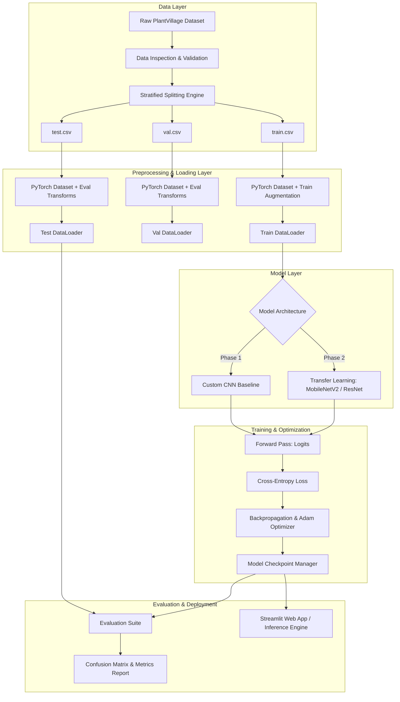

# System Architecture Blueprint

This document outlines the architectural flow of the **Crop Disease Detection** system, from raw image ingestion to user-facing inference.

---

## 🏗️ End-to-End Pipeline

---

## 🧩 Architectural Modules Breakdown

### 1. Data Pipeline (`src/data/`)
- **`download_dataset.py`**: Handles downloading/extracting the PlantVillage repository and filtering specifically for tomato classes.
- **`explore_dataset.py`**: Computes image statistics (dimensions, channels, class distribution, corrupt image detection).
- **`prepare_dataset.py`**: Executes deterministic, stratified splits and generates `splits/train.csv`, `splits/val.csv`, and `splits/test.csv`.
- **`dataset.py`**: Implements custom PyTorch `Dataset` subclass (`PlantVillageTomatoDataset`) wrapping PIL image loading and torchvision transforms.

### 2. Model Zoo (`src/models/`)
- **`cnn.py`**: A structured, modular Convolutional Neural Network designed to make spatial feature extraction, pooling, and flattened fully connected layers intuitive.
- **`transfer_learning.py`**: Pretrained backbone loaders (MobileNetV2, ResNet18) with custom classification heads tailored to 10 tomato classes.

### 3. Training & Validation Engine (`src/training/`)
- **`train.py`**: Manages the epoch loop: mini-batch iteration, device transfer (MPS/CPU), forward pass, loss calculation, backprop, optimizer stepping, and best-model checkpointing.
- **`evaluate.py`**: Evaluates model performance on the holdout test set without gradient tracking (`torch.no_grad()`).

### 4. Metrics & Diagnostics (`src/evaluation/`)
- **`metrics.py`**: Calculates multi-class accuracy, precision, recall, and F1-score (macro and per-class).
- **`plots.py`**: Produces publication-grade confusion matrices and training loss/accuracy history plots.
- **`error_analysis.py`**: Isolates misclassified samples to diagnose whether errors stem from visual ambiguity, illumination, or overlapping symptoms.

### 5. Utility & Reproducibility (`src/utils/`)
- **`device.py`**: Automatically detects Apple Silicon hardware acceleration (`mps`) with graceful CPU fallback.
- **`reproducibility.py`**: Sets identical random seeds across Python, NumPy, and PyTorch (CPU and MPS).
- **`logging_config.py`**: Provides structured standard logging output.

### 6. Interactive Demo (`app/`)
- **`app.py`**: Streamlit interface allowing farmers or judges to upload leaf photos, preview the preprocessed tensor, inspect class probabilities, and review model explanations.
