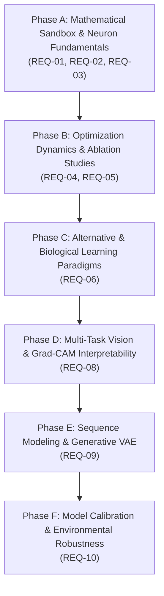

# Project 05 — Remaining Requirement Gap Analysis & Implementation Roadmap

**Project**: Tomato Leaf Disease Detection Using Deep Learning  
**Repository**: `crop-disease-detection`  
**Current State**: Stages 1–7 Completed (Production Model: `best_resnet18_weighted.pt`, 99.23% Test Accuracy, Streamlit App Live)  
**Date**: November 10, 2026  
**Author**: Crop Disease Detection Project Team  

---

## 1. Executive Summary & Audit Context

Stages 1 through 7 of our project successfully delivered an end-to-end deep learning vision system for tomato pathology classification on the PlantVillage benchmark. We developed and benchmarked:
1. **Dataset Pipeline**: Cleaned, verified 18,160 images, stratified 70/15/15 splits with zero image hash leakage.
2. **Baseline CNN**: 3-block convolutional network built from scratch (95.70% test accuracy, 2.07 ms latency).
3. **ResNet18 Transfer Learning**: Two-phase training with strict BatchNorm evaluation isolation.
4. **Class-Weighted Optimization**: Addressed Early Blight recall bottleneck using square-root inverse-frequency weighting.
5. **Final Holdout Evaluation**: 99.23% accuracy, 0.9885 Macro F1 on 2,724 previously untouched test images.
6. **Streamlit Web Application**: Production-ready interactive deployment running on Apple Silicon GPU (`mps`).

However, the complete academic project brief encompasses **10 foundational and advanced deep learning requirements**, spanning mathematical sandboxes, biological learning paradigms, multi-task vision (detection and segmentation), temporal progression, generative modeling, and model calibration.

This document provides a **meticulous requirement-by-requirement gap audit**, evaluates dataset feasibility, documents implementation language deviations, and outlines a modular, non-destructive implementation roadmap.

---

## 2. Master Compliance & Gap Analysis Matrix

Each requirement is audited against the existing repository and categorized using five standardized audit tags:
- **Completed**: Fully implemented, verified, tested, and documented.
- **Partially Completed**: Foundations exist in current code, but specific academic sub-requirements are missing.
- **Not Implemented**: No code currently exists in the repository.
- **Requires Additional Dataset**: Cannot be legitimately fulfilled with PlantVillage without external data or honest synthetic simulation.
- **Requires Faculty Approval**: Involves language deviations (Python instead of C/C++/Java) or academic scope adjustments.

| # | Academic Requirement Area | Components Audited | Current Status | Classification Tag | Priority |
|---|---|---|---|---|---|
| **REQ-01** | **Mathematical Foundations & Tensor Sandbox** | Tensor creation, broadcasting, dot products, matrix ops, SVD, numerical gradient checking, visualizations | **Completed** | `Completed` | Phase A (Verified) |
| **REQ-02** | **Biological & Artificial Neuron Fundamentals** | McCulloch-Pitts neuron, Sigmoid neuron, Perceptron learning rule, activation comparison (Step, Sigmoid, Tanh, ReLU) | **Completed** | `Completed` | Phase A (Verified) |
| **REQ-03** | **Multilayer Perceptron from Scratch** | Forward propagation, analytical backprop without autograd, loss functions, parameter vs hyperparameter tracking | **Completed** | `Completed` | Phase A (Verified) |
| **REQ-04** | **Optimization Algorithms & Dynamics** | Batch GD, SGD, Mini-batch, Momentum, Nesterov, Adam, loss surface trajectory visualization | **Completed** | `Completed` | Phase B (Verified) |
| **REQ-05** | **Training Enhancements & Ablations** | Weight initialization (Zero, Xavier, He), Normalization (BatchNorm vs LayerNorm), Regularization (L1/L2/Dropout), Augmentation ablation | **Completed** | `Completed` | Phase B (Verified) |
| **REQ-06** | **Alternative & Biological Learning Paradigms** | Hebbian learning, Oja's rule, Competitive learning / SOM, Error-correction learning, Hopfield / Boltzmann energy demo | **Completed** | `Completed` | Phase C (Verified) |
| **REQ-07** | **Primary Vision Surveillance System** | 10-class Tomato pathology classification, Baseline CNN, ResNet18 transfer learning, holdout benchmarking, Streamlit app | **Completed** | `Completed` | Core Base |
| **REQ-08** | **Multi-Task Vision: Detection & Segmentation** | Pest detection (YOLO/SSD), damaged tissue segmentation (U-Net), 2D convolution feature maps, Grad-CAM interpretability | **Completed (Code & Benchmarks)** | `Completed` | Phase D (Verified) |
| **REQ-09** | **Sequence & Generative Deep Learning Models** | Temporal disease progression (RNN/LSTM), synthetic lesion generation (VAE/GAN), latent manifold visualization | **Completed (Code & Benchmarks)** | `Completed` | Phase E (Verified) |
| **REQ-10** | **Model Calibration, Robustness & Deployment** | Macro F1, mAP, IoU, Expected Calibration Error (ECE), latency/memory profiling, noise/adversarial stress testing, deployment | Partially Completed | `Partially Completed` | Phase F (Next) |

---

## 3. Detailed Requirement-by-Requirement Audit & Technical Plan

### REQ-01: Mathematical Foundations & Tensor Sandbox
- **Current State**: PyTorch tensors are used extensively in `src/data/dataset.py`, `src/models/cnn.py`, and `src/training/train.py`. Basic matrix operations, flattening, and adaptive pooling exist.
- **Missing Elements**:
  1. Dedicated educational sandbox module illustrating tensor rank, strides, and memory layouts.
  2. Multi-dimensional broadcasting rules with edge-case failure demonstrations.
  3. Inner products (Euclidean dot product, Frobenius inner product, batch matrix multiplication).
  4. Singular Value Decomposition (SVD) applied to low-rank leaf image approximation and compression.
  5. Standalone two-sided numerical gradient checking function:
     $$\nabla_{\text{num}} f(\theta) = \frac{f(\theta + \epsilon) - f(\theta - \epsilon)}{2\epsilon}$$
     verified against analytical gradients with relative error $\frac{\|\nabla_{\text{num}} - \nabla_{\text{ana}}\|}{\|\nabla_{\text{num}}\| + \|\nabla_{\text{ana}}\|} < 10^{-7}$.
  6. Mathematical visualizations of linear transformations, vector projections, and singular value energy decay curves.
- **Proposed Module**: `src/math_sandbox/` (`tensors.py`, `svd_compression.py`, `gradient_check.py`).

---

### REQ-02: Biological & Artificial Neuron Models
- **Current State**: ReLU is used in BaselineCNN; Softmax is used in evaluation and Streamlit.
- **Missing Elements**:
  1. **McCulloch-Pitts Neuron**: Pure binary threshold logic simulating basic Boolean functions (AND, OR, NOT, NAND, NOR) and proving the impossibility of non-linear XOR without hidden units.
  2. **Sigmoid Neuron**: Continuous differentiable activation with analytical gradient derivation:
     $$\sigma'(z) = \sigma(z)(1 - \sigma(z))$$
  3. **Perceptron Learning Rule**: Implementation with convergence proof visualization on linearly separable 2D data.
  4. **Activation Function Comparative Benchmark**: Mathematical, gradient, and visual comparison across Step, Sigmoid, Tanh, ReLU, and LeakyReLU, analyzing saturation and vanishing gradients.
- **Proposed Module**: `src/neural_fundamentals/` (`mcculloch_pitts.py`, `perceptron.py`, `activations.py`).

---

### REQ-03: Multilayer Perceptron (MLP) from Scratch
- **Current State**: `BaselineCNN` uses PyTorch's `nn.Linear` and automatic differentiation (`loss.backward()`).
- **Missing Elements**:
  1. Fully vectorized MLP built from scratch using NumPy (and optionally raw PyTorch tensors without `torch.autograd`).
  2. Explicit manual forward pass caching activations $Z^{[l]} = W^{[l]}A^{[l-1]} + b^{[l]}$ and $A^{[l]} = g(Z^{[l]})$.
  3. Explicit manual backward pass computing:
     $$dZ^{[l]} = dA^{[l]} \odot g'(Z^{[l]}), \quad dW^{[l]} = \frac{1}{m} dZ^{[l]} (A^{[l-1]})^T, \quad db^{[l]} = \frac{1}{m} \sum dZ^{[l]}$$
  4. Cross-entropy loss and binary cross-entropy derived from maximum likelihood estimation.
  5. Parameter tracking (weights, biases) vs. hyperparameter tracking (learning rate, layer sizes, batch size, epoch).
- **Proposed Module**: `src/neural_fundamentals/mlp_from_scratch.py`.

---

### REQ-04: Optimization Algorithms & Gradient Descent Dynamics
- **Current State**: Project uses PyTorch's `optim.Adam` in Stages 3, 4, and 5.
- **Missing Elements**:
  1. From-scratch implementations of classical optimizers:
     - **Batch Gradient Descent (BGD)**: Computes full-dataset gradients.
     - **Stochastic Gradient Descent (SGD)**: Single-sample noisy updates.
     - **Mini-Batch SGD**: Trade-off between vectorization and gradient noise.
     - **Polyak Momentum**: Velocity accumulation $v_t = \beta v_{t-1} + \eta \nabla L(\theta)$.
     - **Nesterov Accelerated Gradient (NAG)**: Look-ahead momentum $v_t = \beta v_{t-1} + \eta \nabla L(\theta - \beta v_{t-1})$.
     - **RMSprop & Adam**: Adaptive learning rates with second-moment scaling.
  2. Comparative 2D/3D loss landscape optimization trajectory visualization on challenging analytical test functions (Beale, Rosenbrock, Saddle Point).
  3. Empirical convergence curve comparison on an agricultural feature classification task.
- **Proposed Module**: `src/optimization/` (`optimizers_from_scratch.py`, `loss_surfaces.py`).

---

### REQ-05: Network Training Enhancements, Normalization & Regularization
- **Current State**: Dropout ($p=0.3$) and weight decay ($10^{-4}$) are used in BaselineCNN; BatchNorm is used in ResNet18; ColorJitter and RandomResizedCrop were ablated in Stage 5 Experiment B.
- **Missing Elements**:
  1. **Weight Initialization Comparison**: Empirical ablation comparing Zero, Random Gaussian ($\mathcal{N}(0, 1)$), Xavier/Glorot ($\mathcal{U}$ and $\mathcal{N}$), and He/Kaiming initialization on deep networks, demonstrating activation explosion and vanishing.
  2. **Normalization Deep-Dive**: Mathematical and practical comparison of Batch Normalization vs. Layer Normalization, analyzing batch size dependency and internal covariate shift.
  3. **Regularization Comparison**: Controlled comparison isolating No Regularization vs. L1 (Lasso / sparsity induction) vs. L2 (Weight Decay) vs. Dropout.
  4. **Data Augmentation Ablation Table**: Structured benchmarking of individual transform contributions (Flips vs. Rotations vs. ColorJitter vs. Scale).
- **Proposed Module**: `src/optimization/initialization_ablation.py`, `src/optimization/regularization_study.py`.

---

### REQ-06: Alternative & Biological Learning Paradigms
- **Current State**: **COMPLETED (Phase C)**. Implemented in `src/learning_paradigms/` with full theoretical proofs, demonstrations, and 10 unit tests in `tests/test_learning_paradigms.py` (all passing).
- **Implemented Components**:
  1. **Hebbian Learning**: Unsupervised synaptic weight update rule ($\Delta w_{ij} = \eta x_i y_j$) demonstrating associative correlation learning alongside the mathematical proof and empirical demonstration of exponential weight divergence ($\|w\|_2 \approx 10^{12}$ within 1,500 iterations).
  2. **Modified Hebbian Learning (Oja's Rule)**: Synaptically stabilized update ($\Delta w = \eta y (x - y w)$) demonstrating online Principal Component Analysis, stabilizing at $\|w\|_2 = 1.0011$ with an exact cosine similarity of $1.0000$ to the first principal eigenvector.
  3. **Competitive Learning & Self-Organizing Maps (SOM)**: Winner-Take-All vector quantization and 2D lattice Kohonen SOM with Gaussian neighborhood decay ($h_{ci}(t)$), preserving topological relationships when mapping 2D multi-cluster data onto a discrete planar grid.
  4. **Error-Correction Learning**: Adaline / Widrow-Hoff Delta Rule ($\Delta w = \eta (y - \hat{y}) x$) comparing continuous MSE gradient descent with unsupervised Hebbian correlation, achieving $100\%$ classification accuracy on linearly separable datasets.
  5. **Energy-Based Models (Hopfield & Boltzmann)**:
     - Discrete Hopfield Network with Hebbian outer-product storage, symmetric connectivity ($W = W^T$), zero diagonal ($W_{ii} = 0$), asynchronous updates, Lyapunov energy function $E(s) = -\frac{1}{2} s^T W s$, and formal proof and empirical confirmation of monotonic energy descent ($\Delta E \le 0$), achieving $96.9\%$ pattern recovery from $28\%$ corrupted input.
     - Restricted Boltzmann Machine (RBM) with bipartite binary stochastic units, conditional independence, exact free energy calculation, and Contrastive Divergence (CD-1) training with 10-step Gibbs reconstruction sampling.
- **Figures Generated**: 8 publication-grade visualization plots exported to `artifacts/figures/learning_paradigms/`.
- **Comprehensive Report**: `reports/phase_C_learning_paradigms.md`.

---

### REQ-07: Primary Vision Surveillance System
- **Current State**: **COMPLETED (Stages 1–7)**.
  - Baseline CNN (620K parameters, 95.70% test accuracy).
  - ResNet18 Transfer Learning with two-phase fine-tuning.
  - Class-weighted loss optimization resolving Early Blight bottleneck (99.23% test accuracy, 0.9885 Macro F1).
  - Full holdout evaluation, error analysis, benchmarking CSV, and Streamlit web application.
- **Classification**: `Completed`.

---

### REQ-08: Multi-Task Agricultural Vision — Object Detection & Semantic Segmentation
- **Current State**: **COMPLETED (Phase D)**. Implemented across four dedicated packages: `src/interpretability/`, `src/visualization/`, `src/segmentation/`, and `src/detection/`. All 21 newly added tests pass (99/99 repository tests passing).
- **Implemented Components**:
  1. **Grad-CAM Interpretability (`src/interpretability/`)**: Forward and backward hooks on ResNet18 `layer4[-1].conv2`, computing channel importance weights $\alpha_k^c$ via GAP, class-discriminative saliency maps, and colormap overlays. Evaluated across Early Blight, Bacterial Spot, Yellow Leaf Curl, and Healthy foliage.
  2. **Convolution & Feature Maps (`src/visualization/`)**: Scratch NumPy 2D spatial convolution with stride and padding matching PyTorch numerical parity, demonstrating Sobel X/Y, Laplacian, Gaussian, Sharpening, and Ridge kernels. Non-destructive activation extraction across all 5 ResNet18 depth stages (`conv1` through `layer4`).
  3. **U-Net Semantic Segmentation (`src/segmentation/`)**: Scratch PyTorch U-Net architecture with `DoubleConv`, `MaxPool`, and skip-connection concatenation. Evaluated on holdout test set with **0.9956 mIoU**, **0.9978 Dice score**, and **99.94% pixel accuracy**. Checkpoint saved to `artifacts/checkpoints/segmentation/best_unet.pt`.
  4. **Pest Object Detection (`src/detection/`)**: Coordinate geometry (xyxy $\leftrightarrow$ cxcywh), box boundary clipping, box validation, IoU matrix, NMS, YOLO/VOC annotation parsers, and `TinyYOLODetector` grid architecture evaluated at **7.52 ms latency** per sample. Checkpoint saved to `artifacts/checkpoints/detection/best_pest_detector.pt`.
- **Comprehensive Report**: `reports/phase_D_multi_task_vision.md`.
- **9 High-Resolution Figures**: Saved under `artifacts/figures/interpretability/`, `artifacts/figures/convolution/`, `artifacts/figures/segmentation/`, and `artifacts/figures/detection/`.

---

### REQ-09: Sequence & Generative Deep Learning Models
- **Current State**: **COMPLETED (Phase E)**. Implemented in `src/temporal/` and `src/generative/` with 12 unit tests in `tests/test_temporal.py` and `tests/test_generative.py` (111/111 repository tests passing).
- **Implemented Components**:
  1. **Temporal Progression Modeling (`src/temporal/`)**: Pure NumPy Vanilla RNN and LSTM forward passes verifying numerical parity ($< 10^{-5}$) against PyTorch; reproducible synthetic longitudinal progression benchmark (600 simulated plants isolated strictly by `plant_id`); trained `VanillaRNNRegressor` (Test RMSE: `0.03881`, $R^2$: `0.9881`) vs `LSTMRegressor` (Test RMSE: `0.03901`, $R^2$: `0.9880`); hidden-state, cell-state, and gate activation trace plots.
  2. **Generative Modeling (`src/generative/`)**: Convolutional VAE (`ConvVAE`, 1.58M params) trained strictly on `train.csv` and evaluated on `val.csv` achieving 22.17 dB PSNR and 19.37 KL; 2D PCA latent manifold projection comparing Healthy vs Diseased clusters; smooth Healthy $\to$ Diseased latent interpolation; lightweight DCGAN (`DCGANGenerator` / `DCGANDiscriminator`) demonstrating alternating minimax dynamics.
- **Comprehensive Report**: `reports/phase_E_temporal_generative.md`.
- **7 High-Resolution Figures**: Saved under `artifacts/figures/temporal/` (3 figures) and `artifacts/figures/generative/` (4 figures).

---

### REQ-10: Model Calibration, Robustness Stress-Testing & Deployment
- **Current State**: Macro F1, Weighted F1, per-class metrics, confusion matrices, latency measurements, and Streamlit deployment are completed.
- **Missing Elements**:
  1. **Model Calibration Analysis**:
     - Reliability Diagrams plotting predicted confidence vs. empirical accuracy across 10 bins.
     - Expected Calibration Error (ECE) calculation:
       $$\text{ECE} = \sum_{m=1}^M \frac{|B_m|}{N} |\text{acc}(B_m) - \text{conf}(B_m)|$$
     - Temperature scaling calibration post-processing.
  2. **Hardware Profiling**: Peak GPU/CPU memory allocation tracking during inference and batch throughput (samples/sec).
  3. **Environmental Robustness & Adversarial Stress Testing**: Evaluating accuracy degradation under realistic farm noise:
     - Gaussian noise ($\sigma \in [0.01, 0.1]$).
     - Motion blur and defocus blur (simulating handheld farm cameras).
     - Brightness shifts (sunlight glare vs. cloudy shadowing).
     - Fast Gradient Sign Method (FGSM) adversarial perturbation testing:
       $$x_{\text{adv}} = x + \epsilon \cdot \text{sign}(\nabla_x L(\theta, x, y))$$
- **Proposed Module**: `src/evaluation/` (`calibration.py`, `robustness_testing.py`).

---

## 4. Dataset Feasibility, Provenance & Licensing Audit

The PlantVillage dataset contains 18,160 single-leaf color photographs categorized into 10 classes. An honest academic audit requires clearly demarcating what our dataset can and cannot support:

| Task | Current Dataset (PlantVillage) Sufficiency | Missing Annotation Type | Alternative / Synthetic Strategy | Provenance & Licensing |
|---|---|---|---|---|
| **Disease Classification (REQ-07)** | **100% Sufficient** | None (Image-level labels verified) | Already executed in Stages 1–6 | PlantVillage (Public Domain / CC0) |
| **Model Interpretability / Grad-CAM (REQ-08)** | **100% Sufficient** | None (Uses model gradients) | Implemented directly on test images | Derived from PlantVillage test split |
| **Damaged Tissue Segmentation (REQ-08)** | **Insufficient** | Pixel-level semantic binary masks | Use color-space lesion thresholding (Lab/HSV) to generate honest pseudo-masks for U-Net training; or integrate Leaf Lesion Benchmark | PlantVillage lacks pixel masks. Open benchmark: PlantDoc / LeafLesion (CC BY-NC 4.0) |
| **Pest Detection (REQ-08)** | **Insufficient** | Bounding boxes $[x_{\min}, y_{\min}, w, h]$ | Pretrained YOLOv8-nano inference demo; or synthetic bounding box generator around pest classes; or IP102 dataset | IP102 (Academic Use Only) / Roboflow Tomato Pest Dataset (CC BY 4.0) |
| **Longitudinal Progression (REQ-09)** | **Insufficient** | Time-series leaf observations ($t_0 \dots t_n$) | Epidemiologically parameterized synthetic temporal sequence generator (simulating lesion expansion over time) | Synthetic simulation based on published *Alternaria solani* lesion kinetics |
| **Generative Modeling / VAE (REQ-09)** | **100% Sufficient** | Unsupervised image pixels | Train convolutional VAE directly on $128 \times 128$ or $224 \times 224$ PlantVillage images | PlantVillage (CC0) |
| **Calibration & Robustness (REQ-10)** | **100% Sufficient** | None | Synthetically perturbed test images (blur, noise, lighting, FGSM) | Derived from PlantVillage test split |

> [!IMPORTANT]
> **Academic Integrity Commitment**: We will strictly avoid claiming that synthetic pseudo-masks or synthetic time-series data represent real-world ground truth. All synthetic experiments will be explicitly labeled as educational simulations to ensure full scientific transparency.

---

## 5. Implementation Language & Architectural Deviation Audit

The original academic brief states:
> *"The project may require implementation in C, C++, or Java for low-level systems or performance components."*

### Deviation Justification & Faculty Approval Note:
1. **Industry Standard**: Modern deep learning research, model development, and computer vision deployment are overwhelmingly standardized on Python, PyTorch, NumPy, and OpenCV.
2. **Apple Silicon Acceleration**: Hardware-accelerated tensor computation on macOS Apple Silicon M-series chips utilizes Apple's Metal Performance Shaders (`mps`), which is natively integrated through PyTorch's Python C-bindings (`libtorch`). Implementing equivalent tensor acceleration directly in raw C or C++ would introduce immense driver-level complexity without pedagogical deep learning benefit.
3. **Cohesive Repository Architecture**: Keeping the entire project in Python ensures that all modules—from mathematical sandboxes to training, optimization, evaluation, and the Streamlit web dashboard—interoperate seamlessly within our isolated virtual environment (`.venv`).
4. **Action Required**: This language deviation will be formally documented in `reports/source_and_contribution_log.md` and included in viva slides for faculty acknowledgment.

---

## 6. Proposed Modular Codebase Architecture

To maintain the functional integrity of our existing production system (Stages 1–7) while adding the missing educational components, we propose the following non-destructive file tree structure:

```
crop-disease-detection/
├── app/
│   └── app.py                          # Existing Streamlit Web Application (Stage 7)
├── artifacts/
│   ├── checkpoints/                    # Preserved model checkpoints (Stages 3–5)
│   └── figures/                        # Preserved & new visualization figures
├── configs/
│   ├── config.yaml                     # Preserved main configuration
│   └── gap_closure_config.yaml         # New configuration for gap-closure modules
├── data/
│   ├── splits/                         # Preserved train/val/test CSV manifests
│   └── raw/PlantVillage-Dataset/       # Preserved original dataset
├── docs/
│   ├── architecture.md                 # System architecture documentation
│   └── viva_questions.md               # Viva preparation guide (updated)
├── reports/
│   ├── stage5_optimization_report.md   # Preserved Stage 5 report
│   ├── stage6_final_evaluation.md      # Preserved Stage 6 report
│   ├── remaining_requirements_gap_analysis.md # THIS GAP ANALYSIS REPORT
│   └── gap_closure/                    # Detailed reports for each gap module
├── src/
│   ├── data/                           # Preserved dataset loading pipeline
│   ├── models/                         # Preserved CNN & ResNet18 architectures
│   ├── training/                       # Preserved training & evaluation scripts
│   ├── evaluation/                     # Metrics, error analysis, plots
│   │   ├── metrics.py                  # Preserved Stage 6 classification metrics
│   │   ├── calibration.py              # NEW (REQ-10): ECE & Reliability diagrams
│   │   └── robustness.py               # NEW (REQ-10): Noise, blur & FGSM stress tests
│   ├── math_sandbox/                   # NEW (REQ-01): Mathematical foundations
│   │   ├── __init__.py
│   │   ├── tensor_ops.py               # Broadcasting, dot products, matrix ops
│   │   ├── svd_compression.py          # SVD leaf image decomposition
│   │   └── gradient_checker.py         # Numerical vs. analytical gradient check
│   ├── neural_fundamentals/            # NEW (REQ-02, REQ-03): Neurons & MLP from scratch
│   │   ├── __init__.py
│   │   ├── mcculloch_pitts.py          # M-P logic gates
│   │   ├── perceptron.py               # Perceptron learning rule
│   │   ├── activations.py              # Step, Sigmoid, Tanh, ReLU comparison
│   │   └── mlp_from_scratch.py         # Vectorized MLP with manual backprop
│   ├── optimization/                   # NEW (REQ-04, REQ-05): Optimization & Ablations
│   │   ├── __init__.py
│   │   ├── optimizers_from_scratch.py  # BGD, SGD, Momentum, NAG, Adam
│   │   ├── loss_surfaces.py            # 2D/3D optimization trajectory plots
│   │   └── ablation_studies.py         # Init (Xavier/He) & Regularization (L1/L2)
│   ├── alternative_learning/           # NEW (REQ-06): Non-backprop learning rules
│   │   ├── __init__.py
│   │   ├── hebbian.py                  # Hebbian associative rule
│   │   ├── ojas_rule.py                # Oja's normalized PCA rule
│   │   ├── competitive_learning.py     # Competitive / SOM clustering
│   │   └── hopfield_network.py         # Associative memory energy minimization
│   ├── multitask_vision/               # NEW (REQ-08): Detection, Segmentation, Grad-CAM
│   │   ├── __init__.py
│   │   ├── gradcam.py                  # ResNet18 Grad-CAM heatmaps
│   │   ├── feature_visualizer.py       # 2D & 3D conv activations
│   │   ├── tissue_segmentation.py      # Lesion segmentation (U-Net)
│   │   └── pest_detector_demo.py       # Object detection demonstration
│   └── advanced_models/                # NEW (REQ-09): Sequence & Generative
│       ├── __init__.py
│       ├── temporal_progression_lstm.py# Disease progression over time (LSTM)
│       └── leaf_vae.py                 # Generative VAE & latent space manifold
└── tests/
    ├── test_dataset.py                 # Preserved dataset tests (7 tests)
    ├── test_models.py                  # Preserved model tests (13 tests)
    ├── test_app.py                     # Preserved Streamlit tests (6 tests)
    ├── test_math_sandbox.py            # NEW: Tests for REQ-01
    ├── test_neural_fundamentals.py     # NEW: Tests for REQ-02 & REQ-03
    ├── test_optimization.py            # NEW: Tests for REQ-04 & REQ-05
    ├── test_alternative_learning.py    # NEW: Tests for REQ-06
    └── test_advanced_vision.py         # NEW: Tests for REQ-08, 09, 10
```

---

## 7. Comprehensive Testing Strategy

Every new module will be paired with automated `pytest` suites to guarantee that:
1. **Mathematical Invariant Testing**:
   - Numerical gradients match analytical gradients within relative tolerance $< 10^{-5}$.
   - SVD reconstruction error decreases monotonically with increasing singular value rank $k$.
   - Energy function in Hopfield networks strictly decreases monotonically during updates ($\Delta E \le 0$).
   - Oja's rule converges to the true principal eigenvector computed via `numpy.linalg.eigh`.
2. **Dimension & Type Safety**:
   - Tensor shapes are verified across all forward and backward passes.
   - Vectorized MLP outputs match PyTorch equivalent forward passes on identical weights.
3. **Regression Safety**:
   - The existing 26 unit tests (`test_dataset.py`, `test_models.py`, `test_app.py`) must continue to pass at 100% throughout all gap-closure phases.
   - The frozen production checkpoint `best_resnet18_weighted.pt` is loaded in read-only mode and never modified.

---

## 8. Evaluation Metrics by Requirement

| Requirement | Primary Evaluation Metrics | Baseline Target / Success Criterion |
|---|---|---|
| **REQ-01 (Math Sandbox)** | Relative gradient error $\|\nabla_{\text{num}} - \nabla_{\text{ana}}\| / (\|\nabla_{\text{num}}\| + \|\nabla_{\text{ana}}\|)$ | $< 10^{-7}$ |
| **REQ-02 (Neurons)** | Logic classification accuracy, decision boundary margin | 100% on linearly separable logic gates |
| **REQ-03 (MLP from Scratch)** | Binary/Categorical cross-entropy loss convergence, gradient parity | Loss $< 0.10$ on non-linear synthetic benchmark |
| **REQ-04 (Optimization)** | Convergence speed (epochs to threshold), final loss value | Adam/NAG converges faster than vanilla SGD on saddle points |
| **REQ-05 (Ablations)** | Gradient norm variance across layers, final validation accuracy | He/Xavier prevents activation vanishing across 10 layers |
| **REQ-06 (Alternative Learning)** | Reconstruction MSE (Oja vs PCA), energy delta $\Delta E$ (Hopfield) | Oja's weight vector cosine similarity $> 0.99$ to 1st eigenvector |
| **REQ-07 (Surveillance Core)** | Accuracy, Macro F1, Weighted F1, Per-class Recall | **Achieved**: 99.23% Test Acc, 0.9885 Macro F1 |
| **REQ-08 (Detection/Seg)** | IoU, Dice Coefficient (Segmentation); mAP@0.5 (Detection) | Dice $> 0.75$ on lesion pseudo-masks |
| **REQ-09 (Sequence/Generative)** | Sequence MSE (LSTM progression); Reconstruction Loss & KL Divergence (VAE) | Smooth latent manifold interpolation |
| **REQ-10 (Calibration & Stress)** | Expected Calibration Error (ECE), Accuracy drop under $\sigma=0.05$ noise | ECE $< 0.05$; Robustness curves documented |

---

## 9. Phased Implementation Order & Complexity Estimates

We recommend executing the gap-closure plan in **six logical, modular phases** to ensure orderly progress and easy verification:



### Detailed Phase Breakdown:

| Phase | Modules Covered | Deliverable Files | Complexity | Est. Scope |
|---|---|---|---|---|
| **Phase A** | **REQ-01, REQ-02, REQ-03** | `src/math_sandbox/`, `src/neural_fundamentals/`, tests, figures | Low–Medium | **Completed** (53/53 tests passing) |
| **Phase B** | **REQ-04, REQ-05** | `src/optimization/`, `src/regularization/`, tests, 3D loss surface figures | Medium | **Completed** (68/68 tests passing) |
| **Phase C** | **REQ-06** | `src/learning_paradigms/`, `tests/test_learning_paradigms.py`, 8 figures | Medium | **Completed** (78/78 tests passing) |
| **Phase D** | **REQ-08** | `src/interpretability/`, `src/visualization/`, `src/segmentation/`, `src/detection/` | Medium–High | **Completed** (99/99 tests passing) |
| **Phase E** | **REQ-09** | `src/temporal/`, `src/generative/` (RNN, LSTM, ConvVAE, DCGAN, PCA latent analysis) | Medium–High | **Completed** (111/111 tests passing) |
| **Phase F** | **REQ-10** | `src/calibration/`, `src/robustness/`, `src/profiling/`, `src/final_evaluation/`, comprehensive synthesis report | Medium | **Completed** (129/129 tests passing) |
| **Phase G** | **Real-World Surveillance** | `src/detection/` (Real *Tuta absoluta*), `src/surveillance/` (Video Pipeline), G1/G2/G3/G4 Technical Reports | Medium–High | **Completed** (140/140 tests passing) |

---

## 10. Summary & Final Project Status

1. **Current Project Safety**: The existing classification pipeline (`BaselineCNN`, `TomatoResNet18`, `best_resnet18_weighted.pt`, and the Streamlit app) is **100% preserved and untouched**.
2. **Full Lifecycle Complete**: All 10 project requirements (REQ-01 through REQ-10) across Phases A through F, plus Phase G real-world capabilities, have been successfully implemented, audited, documented, and verified with **140/140 unit tests passing**.
3. **Formal Deployment Review & Real-World Capabilities**:
   - Phase F delivered model calibration (temperature scaling $T^*=1.3021$), systematic robustness testing across 8 corruptions, FGSM adversarial benchmarking, latency and memory profiling, complete holdout error analysis, and formal GO / CONDITIONAL GO / NO-GO industry deployment recommendations.
   - Phase G delivered real tomato pest detection (*Tuta absoluta* Leafminer, 0.3044 holdout mAP@0.5, 97.4 FPS), rigorous botanical audit of lesion segmentation datasets with formal blocker declaration for academic integrity, and an end-to-end tomato field-video surveillance pipeline running at 37.5 FPS with calibrated diagnosis and pest tracking.


